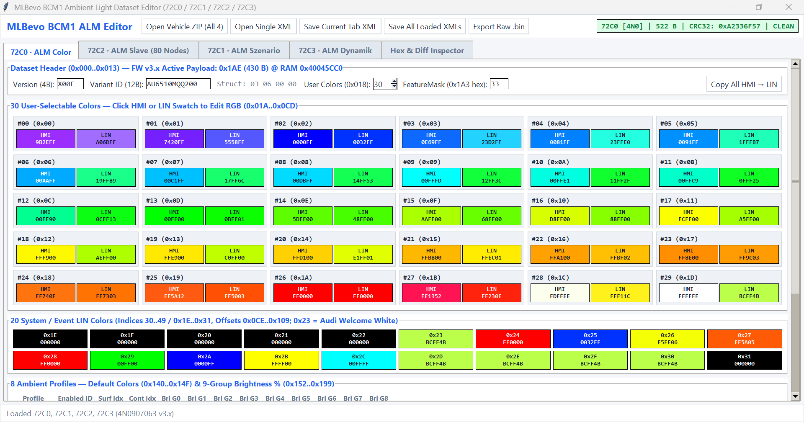
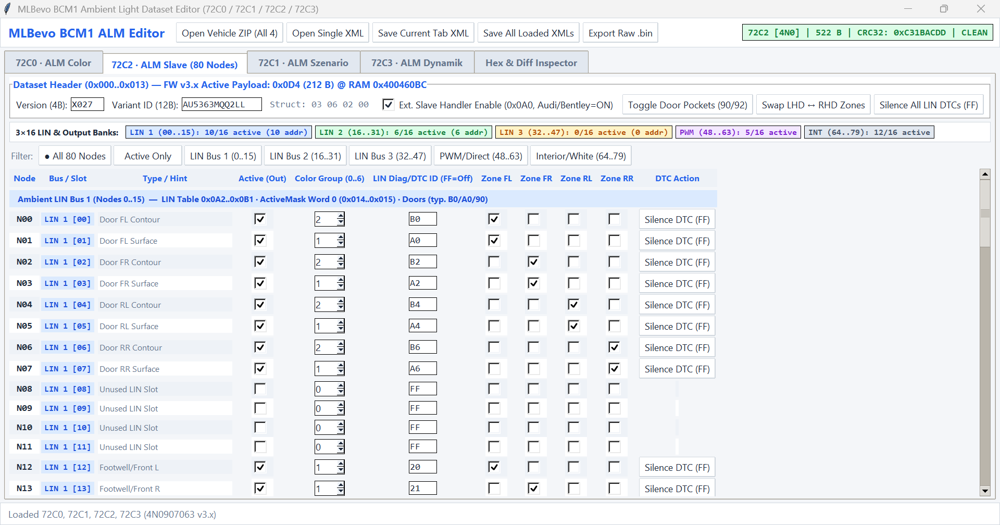
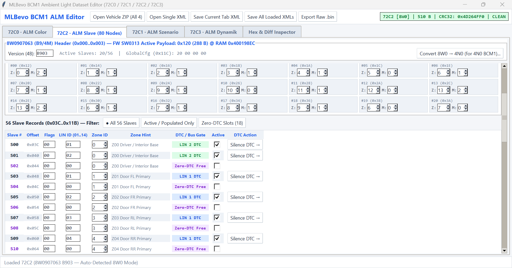
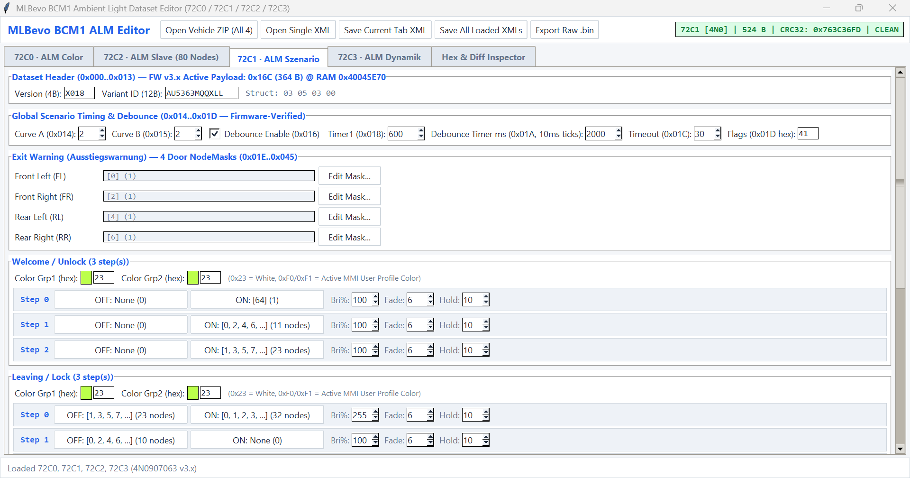
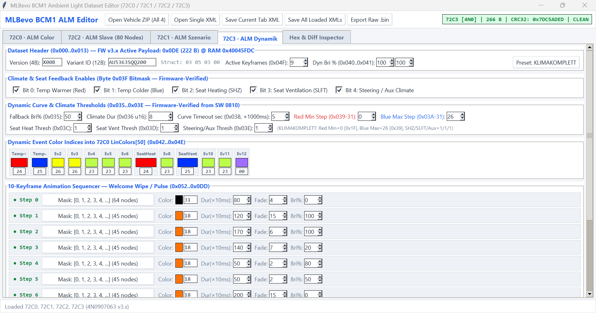
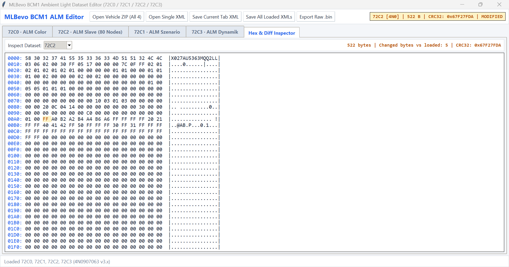

# MLBevo Ambient Light Editor

A standalone Windows GUI tool and Python codec for viewing, editing, converting, and exporting VAG MLBevo **BCM1 (Address 09)** Ambient Lighting datasets (**`72C0`**, **`72C1`**, **`72C2`**, **`72C3`**).

Every offset, bitmask, and DTC mechanism is firmware-verified against real PowerPC e200z4 VLE BCM1 flash images (`FL_4N0907063H_0810` and `FL_8W0907063H_0313`) and round-trip verified across **1,486** factory datasets (**1,283** `4N0` + **203** `8W0`).

---

## Features

- **Automatic Platform Detection (`4N0` & `8W0`)**: Opens individual VAG SW-CNT `.xml` datasets or full vehicle `.zip` archives, automatically detects **`4N0907063`** (v3.x: 522/524/522/266 B) vs **`8W0907063`** (B9/Q5 FY/Q7 4M: 510/254/510/254 B), and recalculates valid Big-Endian IEEE **CRC-32** checksums on export (`.xml` or raw `.bin`).
- **`72C0` — ALM Color**:
  - Edit the 30 MMI/HMI and calibrated LIN RGB color palettes.
  - Edit system/event colors, Drive Select / ambient profile colors (`0x140..0x14F` on `4N0`, direct RGB `0x07B..0x0A4` on `8W0`), and per-zone brightness tables.
- **`72C1` — ALM Szenario**:
  - Edit Welcome, Leaving, Exit Warning, and per-door open lighting sequences, colors, brightness, fade/hold timings, and visual bitmasks (`80-node` picker for `4N0`, `16-zone` picker for `8W0`).
- **`72C2` — ALM Slave**:
  - **`4N0`**: Organized by the firmware-verified **3 × 16 LIN Bus split** (`LIN Bus 1` Doors `0..15`, `LIN Bus 2` Dash/Console/Footwells/Seats `16..31`, `LIN Bus 3` Extended/Rear `32..47`) + `PWM/Direct (48..63)` + `Interior/White (64..79)`.
  - **`8W0`**: Edit the 7 × 16-zone group bitmasks, 21 zone routing/DTC bus configs (`0=Off / 1=LIN Bus 1 / 2=LIN Bus 2`), and 56 × 4-byte slave records.
  - **One-Click DTC Silencing (LEDs Stay ON)**:
    - **`4N0`**: Per-node `Silence DTC (FF)` or global `Silence All LIN DTCs (FF)` (`0x0A2..0x0D1 = FF`, keeping `Active` output enabled).
    - **`8W0`**: Highlights all **18 firmware `ZERO-DTC` slots** (`S02, S04, S06, S08, S10, S14, S16, S18, S20, S22, S25, S31, S45, S47, S49, S51, S53, S55`) with a one-click `Silence DTC →` button that moves active slaves into a `ZERO-DTC` slot while keeping the LED ON.
  - **`8W0 → 4N0` Converter**: Converts an `8W0` `72C2` dataset (510 B) into a `4N0` `STRUCT620` `72C2` dataset (522 B) so `8W0` LEDs can be run on a `4N0` BCM1 (with optional `0xFF` DTC suppression).
- **`72C3` — ALM Dynamik**:
  - Edit climate/seat dynamic feedback enables, event colors, ramp/decay curves, and (on `4N0`) the 10-step Welcome/Wipe/Pulse animation keyframes.
- **Hex & Diff Inspector**: Live hex view highlighting every modified byte vs. the loaded file.

---

## Screenshots

### 1. `72C0` — ALM Color (30 HMI/LIN Palettes, System Colors & Drive Select Profiles)
Edit all 30 MMI/HMI and calibrated LIN RGB swatches (`Copy All HMI → LIN`), 20 system/event colors, 8 Drive Select / ambient profile colors (`Surf Idx` / `Cont Idx`), and per-zone brightness tables.



### 2. `72C2` — ALM Slave (`4N0` Mode: 3×16 LIN Bus Split & One-Click DTC Silencing)
View live active/address counts across **LIN Bus 1** (Doors), **LIN Bus 2** (Dash/Console/Footwells/Seats), **LIN Bus 3** (Extended/Rear), **PWM/Direct**, and **Interior/White** channels. Silence disconnected or retrofit LED DTCs per node (**`Silence DTC (FF)`**) or globally (**`Silence All LIN DTCs (FF)`**) while keeping LED outputs active.



### 3. `72C2` — ALM Slave (`8W0` Mode: 16-Zone Routing, `ZERO-DTC` Slots & `8W0 → 4N0` Converter)
Automatically switches to `8W0907063` layout when loading B9/Q5/Q7 datasets: edit the 7 × 16-zone masks, 21 zone bus/DTC routing modes (`0=Off / 1=LIN1 / 2=LIN2`), and 56 slave records with highlighted firmware **`ZERO-DTC`** slots (**`Silence DTC →`**) and the one-click **`Convert 8W0 → 4N0 (for 4N0 BCM1)`** converter.



### 4. `72C1` — ALM Szenario (Welcome, Leaving, Exit Warning & Per-Door Open)
Configure global ramp/debounce timings, 4-door Exit Warning masks, Welcome/Leaving 3-step animations, and per-door open masks using the visual 80-node (`4N0`) or 16-zone (`8W0`) bitmask picker.



### 5. `72C3` — ALM Dynamik (Climate/Seat Feedback & Welcome/Wipe/Pulse Keyframes)
Toggle climate and seat heating/ventilation feedback (`0x03F` / `0x041`), edit dynamic event colors, ramp/decay curves, and the 10-step Welcome/Wipe/Pulse keyframe sequence (`4N0`).



### 6. Hex & Diff Inspector (Live Byte-Level Diff & CRC-32 Verification)
Inspect the exact serialized payload with real-time highlighting of every modified byte and automatic Big-Endian IEEE CRC-32 recalculation before exporting to XML or raw `.bin`.



---

## Quick Start

### Option 1: Standalone Windows Executable (No Python Required)
Download **`MLBevo_ALM_Editor.exe`** from the [Releases](../../releases) page and double-click to run.

### Option 2: Run from Source
Requires Python 3.10+ (zero external dependencies — standard library + `tkinter` only):
```powershell
python alm_gui.py
```

---

## Documentation
- [4N0907063 (v3.x) `72C0`–`72C3` Structural Specification](docs/4N0907063_72C0_72C3.md)
- [8W0907063 (B9 / Q5 FY / Q7 4M) `72C0`–`72C3` Structural Specification](docs/8W0907063_72C0_72C3.md)

## Contributors
- **mlbevovictor** — Project owner, dataset collection & real-vehicle hardware verification
- **Google Antigravity** — Firmware reverse engineering, Python codec/GUI implementation & documentation
- **REA** ([Reverse Engineer Anything](https://github.com/morluto/rea)) — Binary & artifact analysis framework

## Disclaimer
Modifying vehicle ECU datasets carries inherent risk. Always back up your original BCM1 datasets before flashing with ODIS-E / VCP / VCDS.
