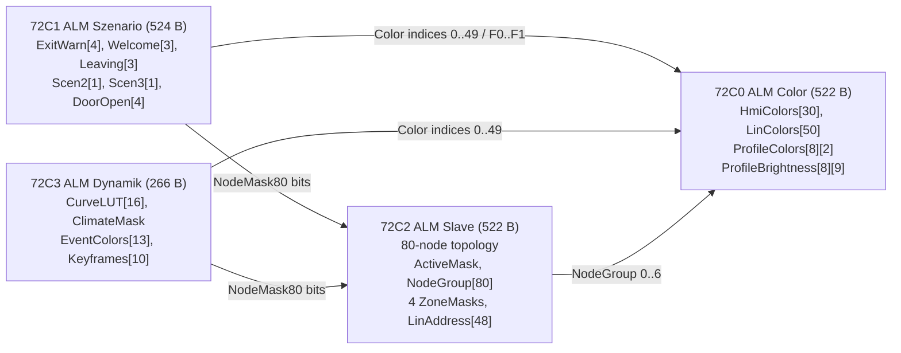

# MLBevo BCM1 `4N0907063` / `8W1907063` (Address 09) Ambient Light Datasets (`72C0`–`72C3`) — Structural Specification

> [!NOTE]
> **Platform Coverage**: Applies identically to **`4N0907063`** (Audi C8 A6/A7/RS6/RS7, D5 A8/S8, Q7/SQ7, Q8/RSQ8, e-tron; Porsche 992/9Y0/9J1; VW Touareg; Bentley; Lamborghini Urus) and **`8W1907063`** (Audi B9/B9.5 A4/S4/RS4/A5/S5/RS5 & Q5/SQ5 FY facelift) — both share the same v3.x BCM1 firmware and dataset layout.

> [!NOTE]
> **Corpus & Evidence Basis**: Derived by cross-analyzing **1,275 dataset instances** (**103 unique binary payloads**) extracted from **246 real-vehicle BCM1 ZIP archives** in `D:\REA\qq2\DATASETS` (4N0/8W1 SW 0633–0775) and all Audi/Porsche ZDC containers in `D:\REA\qq2\ZDC` (including Audi A5/S5/RS5, Q5/SQ5, A6/A7/RS7, A8/S8, Q7/SQ7, Q8/RSQ8, Q8 e-tron, e-tron GT; Porsche 992, Cayenne 9Y0, Taycan 9J1; VW Touareg; Bentley; Lamborghini Urus). Representative archive verified via REA `inspect_artifact` (`ev_5208b3ff724cb55a52a78d0bfa77de23f5c57c9607835254230f11a08bf4934b`, `ev_6e74fe18c429e08c1ebf8e64d6ef64d5d2aec6a2067d47788703388374d081aa`, SHA-256 `e88810446214e47d31e877fa5f54133a382f5d9e3c44e123026125da975b8901`).

---

## 1. Overview & Common Framing

All four datasets are written to BCM1 (`0x09`) via UDS `WriteDataByIdentifier` (`0x2E`) and share an identical **20-byte header**, **4-byte trailing Big-Endian IEEE 802.3 CRC-32**, and **80-node bitmask encoding**:

| Dataset ID | Official ZDC Name | Total Size | Struct Version (`0x010..0x013`) | Unique Payloads | Primary Role |
| :--- | :--- | :---: | :---: | :---: | :--- |
| **`72C0`** | `ALM Color` | **522 B** (`0x20A`) | `03 06 00 00` (`STRUCT600`) | 22 | HMI & calibrated LIN RGB color tables (30 user + 20 system), 8 ambient profiles, 8×9 brightness tables, BAP zone mapping |
| **`72C1`** | `ALM Szenario` | **524 B** (`0x20C`) | `03 05 03 00` (`STRUCT530`) | 27 | Exit-warning masks, Welcome (3-step), Leaving (3-step), 2 single-step scenarios, and per-door open masks (FL/FR/RL/RR) |
| **`72C2`** | `ALM Slave` | **522 B** (`0x20A`) | `03 06 02 00` (`STRUCT620`)* | 40 | Master 80-node topology: active/installed bitmask, per-node color group (0..6), 4 climate/door feedback zones, 48 LIN slave addresses |
| **`72C3`** | `ALM Dynamik` | **266 B** (`0x10A`) | `03 05 03 00` (`STRUCT530`) | 14 | Dynamic curve LUT, climate/seat feedback enables & colors, and 10×14-byte welcome/wipe/pulse animation keyframes |

*\*One early Porsche Cayenne payload (`9Y0_T007`) uses `03 05 02 00` with identical 522-byte length.*

### Common Header (`0x000..0x013`) & Footer (`len-4..len-1`)

| Offset | Size | Type | Description |
| :--- | :---: | :--- | :--- |
| `0x000..0x003` | 4 B | ASCII | Dataset version (e.g., `"X00E"`, `"X020"`, `"X054"`, `"X00C"`) |
| `0x004..0x00F` | 12 B | ASCII | Vehicle / variant / steering / QQ-package identifier (e.g., `"AU6510MQQ200"`, `"AU5167IQQ2LL"`) |
| `0x010..0x013` | 4 B | `uint8[4]` | Structure version (`03 06 00 00` = v3.6.0.0, `03 05 03 00` = v3.5.3.0, `03 06 02 00` = v3.6.2.0) |
| `len-4..len-1` | 4 B | `uint32 BE` | Standard IEEE 802.3 CRC-32 (`zlib.crc32(data[:-4])`), verified **1,275 / 1,275 (100%)** |

### Universal 80-Node Bitmask Encoding (`NodeMask80`, 10 bytes)

Used identically across `72C2`, `72C1`, and `72C3`. Every 10-byte bitmask represents **80 ambient light nodes (indices `0..79`)** stored as **5 × Big-Endian `uint16` words**:

```c
// Word w (0..4) covers nodes [16*w .. 16*w + 15]
// Inside word w: byte[2*w] = high byte (nodes +8..+15), byte[2*w + 1] = low byte (nodes +0..+7)
bool is_node_set(const uint8_t mask[10], int node) {
    int w = node / 16;
    int bit = node % 16;
    uint16_t word = ((uint16_t)mask[2*w] << 8) | mask[2*w + 1];
    return (word >> bit) & 1;
}
```

- **Words 0–2 (Nodes `0..47`)**: Up to **48 LIN RGB Slave LEDs** (3 groups/buses of 16 nodes), directly indexed into `72C2`'s 48-byte LIN address table (`0x0A2..0x0D1`).
- **Word 3 (Nodes `48..63`)**: Up to **16 PWM / Direct-wired / Non-LIN Ambient Outputs** (no LIN address; e.g., footwells, cupholder, handles, center console). Confirmed by `4N0_X020` (QQ0) vs `4N0_X009` (QQ1) toggling only Node 48 (`0x01B`: `7C` → `7D`).
- **Word 4 (Nodes `64..79`)**: Up to **16 Interior / White / Virtual Channels** (Group `0`, e.g., Nodes 64/65 = Front Left/Right interior/footwell lights, confirmed by LHD/RHD swaps in `72C1` `0x05D`, `0x0B7`, `0x0CF` and 2-door Coupe `80A_X028` `LLHINTENEIN`).

---

## 2. Dataset `72C2` — `ALM Slave` (522 B, `03 06 02 00`)

Confirmed directly by the 21-line struct-aligned XML formatting in `DA_009_72C2_4KE_X054_AU5167IQQ2LL_OHNETUERTASCHE.xml` and cross-variant diffs:

| Offset | Size | Field | Observed Semantics & Proof |
| :--- | :---: | :--- | :--- |
| `0x000..0x013` | 20 B | `Header` | Standard 20-byte header (`ver`, `id`, `03 06 02 00`) |
| `0x014..0x01D` | 10 B | `ActiveNodesMask` | `NodeMask80` of **enabled/installed nodes**. Clearing a bit disables a node even if its LIN address remains in `0x0A2..0x0D1`. Proven by: `4KE_X042` vs `4KE_X054` (`OHNETUERTASCHE`) clears only `0x014` bits 0–1 (Nodes 8–9 = LIN `90`/`92`); `8W0_X048` vs `8W0_X049` (Coupe) clears Nodes 10–11 (LIN `B4`/`B6`). |
| `0x01E..0x06D` | 80 B | `NodeGroup[80]` | Per-node color/brightness group assignment (`0..6`): `0` = Fixed white/uncolored, `1` = Surface (`Fläche`), `2` = Contour (`Kontur`), `3..6` = Secondary/special zones (e.g., Footwell, Roof, Treadplates/B&O `F8..FB` = Group `6`). |
| `0x06E..0x077` | 10 B | `ZoneMask[0]` | `NodeMask80` — Reserved / Zone 0 (all `0x00` in all 40 payloads). |
| `0x078..0x081` | 10 B | `ZoneMask[1]` | `NodeMask80` — **Front Left / Driver-side feedback zone** (Climate Temp +/- & Door zone). Proven by LL↔RL diffs (`4KE_X054`/`X055`, `4M8_X027`/`X028`, `4K0_X04F`/`X050`) swapping dashboard/console bits between `ZoneMask[1]` and `ZoneMask[2]`. |
| `0x082..0x08B` | 10 B | `ZoneMask[2]` | `NodeMask80` — **Front Right / Passenger-side feedback zone**. |
| `0x08C..0x095` | 10 B | `ZoneMask[3]` | `NodeMask80` — **Rear Left door feedback zone**. Proven by `8W0_X048` (4-door) vs `8W0_X049` (2-door Coupe) clearing `0x08C` (`04` → `00`). |
| `0x096..0x09F` | 10 B | `ZoneMask[4]` | `NodeMask80` — **Rear Right door feedback zone**. Proven by `8W0_X048` vs `8W0_X049` clearing `0x096` (`08` → `00`). |
| `0x0A0..0x0A1` | 2 B | `SlaveFlags` | `01 00` on all Audi & Bentley payloads (28/40); `00 00` on all Porsche, VW Touareg, and Urus payloads (12/40). |
| `0x0A2..0x0D1` | 48 B | `LinDiagId[48]` | **3 × 16-byte LIN Diagnostic / DTC Fault-Mapping IDs** for Nodes `0..47` (`0x0A2..0x0B1` = LIN Bus 1 Doors, `0x0B2..0x0C1` = LIN Bus 2 Dash/Console/Footwells/Seats, `0x0C2..0x0D1` = LIN Bus 3 Extended/Rear). **Hardware & firmware verified**: lighting-output functions (`0x1586FC`–`0x15D5FE`) drive LIN slots directly by slot index via `ActiveNodesMask` (`0x014..0x01D`) and do not read `0x0A2..0x0D1`; setting a byte here to **`0xFF`** suppresses/disables disconnected-LED DTCs **while keeping the LED enabled and working** (if `Active = 1`). Typical Audi IDs: `B0/B2/B4/B6` = Door Contours (FL/FR/RL/RR), `A0/A2/A4/A6` = Door Surfaces, `90/92/94/96` = Door Pockets (`Türtasche`), `C0..C3` = Seat Contours (`SITZK`), `50..52` = Dashboard, `40..42` = Center Console, `30..35` / `20..25` = Surfaces/Footwells, `F8..FB` = Special/Treadplates. |
| `0x0D2..0x0D3` | 2 B | `Reserved1` | Always `00 00` across all 40 payloads. |
| `0x0D4..0x205` | 306 B | `Padding` | Always `0x00` across all 40 payloads. |
| `0x206..0x209` | 4 B | `CRC32` | Big-Endian IEEE CRC-32. |

---

## 3. Dataset `72C0` — `ALM Color` (522 B, `03 06 00 00`)

| Offset | Size | Field | Observed Semantics & Proof |
| :--- | :---: | :--- | :--- |
| `0x000..0x013` | 20 B | `Header` | Standard 20-byte header (`ver`, `id`, `03 06 00 00`) |
| `0x014..0x017` | 4 B | `FixedColorIdx[4]` | 4 special/white color indices into `LinColors[50]` (Audi: `30 2F 2E 2D` → indices `48, 47, 46, 45` = `BC FF 4B` white; Porsche: `00 00 00 00`). |
| `0x018` | 1 B | `UserColorCount` | Number of user-selectable colors in MMI/PCM: `0x1E` (30) for Audi & Porsche `30FARBEN`, `0x07` (7) for older Porsche, `0x01` for VW QQ0/QQ1. |
| `0x019` | 1 B | `ColorTableMode` | Always `0x01` across all 22 payloads. |
| `0x01A..0x073` | 90 B | `HmiColors[30]` | **30 × 3-byte RGB** (`R, G, B`) displayed in MMI/PCM UI. Unused slots above `UserColorCount` are `00 00 00`. |
| `0x074..0x109` | 150 B | `LinColors[50]` | **50 × 3-byte RGB** (`R, G, B`) sent to physical LIN LEDs (0-based index `0..49`):<br>• `0..29` (`0x074..0x0CD`): Calibrated LED RGB matching `HmiColors[0..29]` (e.g., HMI `FF FF FF` → LIN `AD FF 42` or `BC FF 4B`).<br>• `30..49` (`0x0CE..0x109`): 20 system/event colors referenced by `72C1` and `72C3` (e.g., in Audi `4N0_X00E`: `0x23` [35] = `BC FF 4B` White, `0x24` [36] = `FF 00 00` Red, `0x25` [37] = `00 32 FF` Blue, `0x26` [38] = `F5 FF 06` Yellow, `0x27` [39] = `FF 5A 05` Orange, `0x31` [49] = `00 00 00` Off). |
| `0x10A..0x111` | 8 B | `BapZoneIds[8]` | BAP HMI brightness/zone IDs (`0xFF` = unused). Audi QQ2: `17 13 FF FF 19 1A FF FF`; Audi QQ0/QQ1 & Porsche QQ0: all `FF`; Porsche: `06 15 07 05 FF FF FF FF`; VW QQ2: `05 01 06 07 FF FF FF FF`. |
| `0x112..0x135` | 36 B | `VwExtZoneCfg` | Populated only in VW Touareg (`V00A`/`V00C`/`V00S`); all `0x00` in Audi, Porsche, Bentley, and Urus. |
| `0x136..0x13F` | 10 B | `ColorGroupMap` | Multi-color / group-link config (Audi QQ2: `22 20 FF FF FF FF 01 02 FF FF`; Audi QQ1/QQ0: `02 20 FF FF FF FF 01 02 FF FF` — `01 02` = Color Groups 1 & 2). |
| `0x140..0x14F` | 16 B | `ProfileColors[8][2]` | **8 Profiles × 2 Color Indices** `[SurfaceColorIdx, ContourColorIdx]` (into `LinColors[50]`). E.g. Audi QQ2 `4N0_X00E`: P0=`1D 05`, P1=`23 23`, P2=`23 23`, P3=`23 25`, P4=`27 27`, P5=`23 24` (White/Red), P6=`1C 1C`, P7=`1C 09`. |
| `0x150..0x151` | 2 B | `DefaultBrightness[2]` | Default master / individual brightness in % (`0x00`, `0x32`=50%, `0x64`=100%). |
| `0x152..0x199` | 72 B | `ProfileBrightness[8][9]` | **8 Profiles × 9 Brightness Values** (`0..100%`, `0x00..0x64`) per brightness group. Audi QQ2: `64 64 64 64 64 64 64 64 32` × 8; Porsche uses only Row 0 (`32 32 32 32 00 00 00 00 32`). |
| `0x19A..0x1A2` | 9 B | `EnabledProfiles` | `0x19A` = Default profile (`0x01`), `0x19B..0x1A2` = 8 available profile IDs (`0xFF` = disabled). Audi QQ2: `01 \| 01 02 03 04 05 06 07 09`; QQ1: `01 \| 01 FF..FF`; QQ0: `01 \| FF..FF`. |
| `0x1A3` | 1 B | `FeatureMask` | Enabled HMI/color feature bitmask (`33` Audi QQ2, `11` Audi QQ0/QQ1, `0F` Porsche QQ1/QQ2, `00` Porsche QQ0). |
| `0x1A4..0x1AD` | 10 B | `DimmingParams` | Global dimming/ramp parameters (standard: `02 01 02 32 02 05 1E <qq_flag> 00 00`, where `0x1AB` = `0x00` for QQ2, `0x01` for QQ0/QQ1). |
| `0x1AE..0x205` | 88 B | `Padding` | Always `0x00`. |
| `0x206..0x209` | 4 B | `CRC32` | Big-Endian IEEE CRC-32. |

---

## 4. Dataset `72C1` — `ALM Szenario` (524 B, `03 05 03 00`)

Defines static & staged lighting scenarios (Exit Warning, Welcome, Leaving, Ignition/Crash/Interior, and Per-Door Open). Notice that color index sentinels `0xF0` / `0xF1` (observed in VW `V00A`) mean "use active user Profile Color 1 / Color 2", while `0x00..0x31` index directly into `72C0`'s `LinColors[50]`.

```c
typedef struct {
    uint8_t off_mask[10];   // NodeMask80: nodes to fade OFF in this step
    uint8_t on_mask[10];    // NodeMask80: nodes to fade ON in this step
    uint8_t brightness;     // Target brightness % (0x00..0x64, or 0xFF = current/user)
    uint8_t fade_time;      // Ramp/fade duration (e.g. 0x06 = 600ms, 0x02 = 200ms)
    uint8_t hold_time;      // Step hold/delay (e.g. 0x0A = 1.0s, 0x14 = 2.0s, 0xFF = hold)
    uint8_t flags;          // Step flags (0x00)
} ScenarioStep24;
```

| Offset | Size | Field | Observed Semantics & Proof |
| :--- | :---: | :--- | :--- |
| `0x000..0x013` | 20 B | `Header` | Standard 20-byte header (`ver`, `id`, `03 05 03 00`) |
| `0x014..0x01D` | 10 B | `GlobalTiming` | `[curveA, curveB, 0x01, 0x00, u16_BE(600), u16_BE(2000), 0x1E(30), 0x41(65)]` — global ramp/timeout constants (`curveA/B`: `02 02` Audi/Bentley, `02 06` Porsche, `06 06` VW, `01 01` Urus). |
| `0x01E..0x045` | 40 B | `ExitWarnMask[4]` | **4 × `NodeMask80`** for Exit Warning (`Ausstiegswarnung`) per door: `[0]`=FL (`B0`), `[1]`=FR (`B2`), `[2]`=RL (`B4`), `[3]`=RR (`B6`). |
| `0x046..0x049` | 4 B | `WelcomeHdr` | `[ColorGrp1, ColorGrp2, StepCount=3, Flags=0]` (Audi: `23 23 03 00`; VW QQ2: `F0 F1 03 00`). |
| `0x04A..0x091` | 72 B | `WelcomeSteps[3]` | **3 × `ScenarioStep24`** (`0x04A`, `0x062`, `0x07A`) — staged Unlock/Entry sequence. LL↔RL diff flips `0x05D` (`01`↔`02`, Driver node 64↔65). |
| `0x092..0x095` | 4 B | `LeavingHdr` | `[ColorGrp1, ColorGrp2, StepCount=3, Flags=0]` |
| `0x096..0x0DD` | 72 B | `LeavingSteps[3]` | **3 × `ScenarioStep24`** (`0x096`, `0x0AE`, `0x0C6`) — reverse Lock/Exit sequence. LL↔RL diff flips `0x0B7` (`02`↔`01`) and `0x0CF` (`01`↔`02`). |
| `0x0DE..0x0E1` | 4 B | `Scen2Hdr` | `[ColorGrp1, ColorGrp2, StepCount=1, Flags=0]` — Single-step scenario A (e.g., Driving / Terminal 15 / Interior all-on). |
| `0x0E2..0x0F9` | 24 B | `Scen2Step` | `1 × ScenarioStep24`. |
| `0x0FA..0x0FD` | 4 B | `Scen3Hdr` | `[ColorGrp1, ColorGrp2, StepCount=1, Flags=0]` — Single-step scenario B (e.g., Parking / Reduced ambient). |
| `0x0FE..0x115` | 24 B | `Scen3Step` | `1 × ScenarioStep24`. |
| `0x116..0x11B` | 6 B | `DoorOpenHdr` | `[ColorGrp1, ColorGrp2, StepCount=1, Brightness, FadeTime, HoldTime]` (Audi: `23 23 01 \| 64 06 14`). |
| `0x11C..0x16B` | 80 B | `DoorOpenMasks[4]` | **4 × 20 B** (`off_mask[10] + on_mask[10]`) for **Door Open** (FL=`0x11C`, FR=`0x130`, RL=`0x144`, RR=`0x158`). Proven by `80A_X028` (`LLHINTENEIN`, 2-door Coupe/Cabrio) adding rear bits `0x0C` to FL (`0x12F`: `01`→`0D`) and FR (`0x143`: `02`→`0E`). |
| `0x16C..0x207` | 156 B | `Padding` | Always `0x00` across all 27 payloads. |
| `0x208..0x20B` | 4 B | `CRC32` | Big-Endian IEEE CRC-32. |

---

## 5. Dataset `72C3` — `ALM Dynamik` (266 B, `03 05 03 00`)

Controls dynamic feedback effects (Climate Temp +/-, Seat Heating/Ventilation, Drive Select) and the 10-step Welcome/Wipe (`WISCHEN`) animation sequence.

```c
typedef struct {
    uint8_t node_mask[10];  // NodeMask80: LEDs targeted by this keyframe
    uint8_t color_idx;      // Index into 72C0 LinColors[50] (e.g. 0x18/0x19/0x24/0x31)
    uint8_t duration;       // Hold/step duration (10ms units, e.g. 0x0F=150ms, 0xC8=2.0s)
    uint8_t fade_time;      // Ramp/fade time (e.g. 0x01..0x0F)
    uint8_t brightness;     // Target brightness % (0x00..0x64)
} DynamicKeyframe14;
```

| Offset | Size | Field | Observed Semantics & Proof |
| :--- | :---: | :--- | :--- |
| `0x000..0x013` | 20 B | `Header` | Standard 20-byte header (`ver`, `id`, `03 05 03 00`) |
| `0x014..0x033` | 32 B | `DynamicCurveLut[16]` | **16 × `uint16 BE`**: All zero on Audi & Urus; populated on Porsche, VW, and Bentley with `[0, 2500, 5000, ..., 25000, 25673, 13863, 6931, 3336, 1026]` (11 linear ramp points + 5 exponential decay points). |
| `0x034..0x03E` | 11 B | `DynamicTimingCfg` | Pulse/fade/repeat timing & mode flags (Audi Q8/Q8 e-tron: `00 32 00 08 05 1F 39 04 01 01 01`; `0x03C..0x03E` = `01 01 01` on Audi/Urus vs `00 00 00` on Porsche/VW/Bentley). |
| `0x03F` | 1 B | `ClimateEnableMask` | **Climate & Seat Feedback Enable Bitmask**. Proven by `4M8_X008` vs `4M8_X009` (`KLIMAOHNESHZSLFT`) changing **only** `0x03F` from `0x1F` (`0b11111` = Temp +/- + Seat Heating `SHZ` + Seat Ventilation `SLFT` + Steering/Aux) to `0x03` (`0b00011` = Temp +/- only), and `0x00` in VW `V001` (`OHNE0FPA`). |
| `0x040..0x041` | 2 B | `DynamicBrightness[2]` | Dynamic effect brightness % (always `64 64` = 100%, 100%). |
| `0x042..0x04E` | 13 B | `EventColorIdx[13]` | Color indices into `72C0` `LinColors[50]` for dynamic events. In Audi: `0x042`=`24` (Red = Temp Warmer), `0x043`=`25` (Blue = Temp Colder), `0x044..0x045`=`26 26` (Yellow), `0x046..0x048`=`23 23 23` (White), `0x049`=`24` (Red = Seat Heating), `0x04A`=`23`, `0x04B`=`25` (Blue = Seat Ventilation), `0x04C..0x04D`=`23 23`, `0x04E`=`00`. |
| `0x04F` | 1 B | `KeyframeCount` | Number of active keyframes in `Keyframes[10]`: `0x0A` (10) on A8 `4N0`, `0x09` (9) on Q8/Q8 e-tron/e-tron GT, `0x00` (disabled) on QQ1 / Porsche / VW / Bentley. |
| `0x050..0x051` | 2 B | `AnimBaseCfg` | Base/fallback color index (`0x23` White on Audi) + flags (`0x00`). |
| `0x052..0x0DD` | 140 B | `Keyframes[10]` | **10 × `DynamicKeyframe14`** (`0x052, 0x060, 0x06E, 0x07C, 0x08A, 0x098, 0x0A6, 0x0B4, 0x0C2, 0x0D0`). Proven by `4KE_X00C` (`WISCHEN`), where Steps 4 & 5 sequentially sweep individual LIN nodes (`00 00 00 80` → Node 23, `00 00 00 40` → Node 22) before Steps 6–7 fade out. |
| `0x0DE..0x105` | 40 B | `Padding` | Always `0x00` across all 14 payloads. |
| `0x106..0x109` | 4 B | `CRC32` | Big-Endian IEEE CRC-32. |

---

## 6. Cross-Dataset Architecture



## 7. Firmware-Level Verification (`FL_4N0907063H_0810_011101S_V001_S.odx`)

Decompressed from VAG `ENCRYPT-COMPRESS-METHOD = A0` (byte-flagged 10-bit LZSS, unencrypted) into **PowerPC e200z4 VLE (Big-Endian)** flash banks:
- **`FD_10FLASHDATA.bin`** (`3,407,872 B`, base `0x01040000`): UDS DID `0x72C0`–`0x72C3` handlers (`0x011A01BA`, `0x011A0308`, `0x011A045A`, `0x011A05A8`) and NvM raw RAM buffers (`0x40032668`, `0x40032874`, `0x40032A80`, `0x40032DAC`).
- **`FD_11FLASHDATA.bin`** (`2,097,152 B`, base `0x01380000`): Full ALM application SWC (`0x014C9000..0x014DD800`, file offsets `0x149000..0x15D800`).

### Verified Struct Sizes & Runtime RAM Addresses (`0x149288..0x14939C`)
When the 4-byte struct version at `+0x010` matches v3.x (`03 06 00 00`, `03 05 03 00`, `03 06 02 00`), the firmware copies the exact active payload lengths into v3.x runtime RAM — matching our empirical end offsets to the exact byte:
- **`72C0`**: `0x40032668` → **`0x40045CC0`**, `memcpy` length = **`0x1AE` (430 B)**
- **`72C1`**: `0x40032874` → **`0x40045E70`**, `memcpy` length = **`0x16C` (364 B)**
- **`72C3`**: `0x40032DAC` → **`0x40045FDC`**, `memcpy` length = **`0x0DE` (222 B)**
- **`72C2`**: `0x40032A80` → **`0x400460BC`**, `memcpy` length = **`0x0D4` (212 B)**

### Exact Field Semantics Proven in Machine Code
- **`72C1[0x016]`** (`0x1544AE..0x1544BA`): 1-byte **Debounce/Timer Enable Flag** (`0x01` = enabled).
- **`72C1[0x01A..0x01B]`** (`0x1544D4`, `0x154508`, `0x15451A`): `uint16 BE` **Timer Threshold in exact milliseconds (ms)** (`0x07D0` = `2000 ms`), compared against a 16-bit counter incremented by `+10 ms` per task tick (`e_addi r0, r7, 10`).
- **`72C2[0x0A0]`** (`0x154BFA..0x154C04`): 1-byte boolean enable flag (`0x01` Audi/Bentley, `0x00` Porsche/VW/Urus) gating the extended slave processing block at `0x154C08..0x154D6E`.
- **`72C3[0x014..0x029]`** (`0x1596BC..0x15970E`): 11-point X-axis LUT (`0..25000`, `72C3[0x028]` = max breakpoint `25000`) iterated over 10 intervals (`se_cmpli r0, 10`) for dynamic brightness curve interpolation.
- **`72C3[0x035]`** (`0x159696`): Fallback dynamic brightness % (`0x32` = 50%) when the curve/timer is inactive.
- **`72C3[0x036..0x037]`** (`0x1578FA`): `uint16 BE` climate feedback duration/debounce parameter (`0x0008` Q8/A8 `KLIMAKOMPLETT`, `0x003C` QQ1/Porsche/VW).
- **`72C3[0x038]`** (`0x159678..0x159680`): Timeout in **exact seconds** (multiplied by `0x3E8` = `1000 ms`; `0x05` = `5000 ms`).
- **`72C3[0x039]` & `72C3[0x03A]`** (`0x1576CE..0x1577C2`): **Climate Temperature Feedback Thresholds (stored as `step + 31`)** — `se_subi r25, 31` is executed before comparing the target climate temp against `72C3[0x039] - 31` (min temp for Red/Warmer) and `72C3[0x03A] - 31` (max temp for Blue/Colder), ignoring CAN init/error values `30` (`0x1E`) and `31` (`0x1F`). This explains why `KLIMAKOMPLETT` sets `0x1F` (`0`) and `0x39` (`26`) to trigger on every click, whereas `X008`/`X009` set `0x2E` (`15`) and `0x26` (`7`).
- **`72C3[0x03C..0x03E]`** (`0x1577EE..0x1578EE`): Per-feature minimum level thresholds for **Seat Heating (`SHZ`, 4 seats)**, **Seat Ventilation (`SLFT`, 4 seats)**, and **Steering/Aux Climate (2 zones)** (`01 01 01` on Audi, `00 00 00` on Porsche/VW/Bentley).
- **`72C3[0x03F]`** (`0x1576BA`): Confirmed **Climate & Seat Feedback Enable Bitmask** (Bit 0 = Temp+, Bit 1 = Temp-, Bit 2 = SHZ, Bit 3 = SLFT, Bit 4 = Aux).
- **`72C0[0x112..0x135]`**: **0 references** in Audi v3.x runtime RAM (`0x40045DD2..0x40045DF5`), confirming it is unused by Audi v3.x ALM logic in SW `0810` (whereas in the legacy v0.4.4.5 path at `0x1509CE`, `+0x115` gates 30-entry HMI→LIN RGB remapping).

